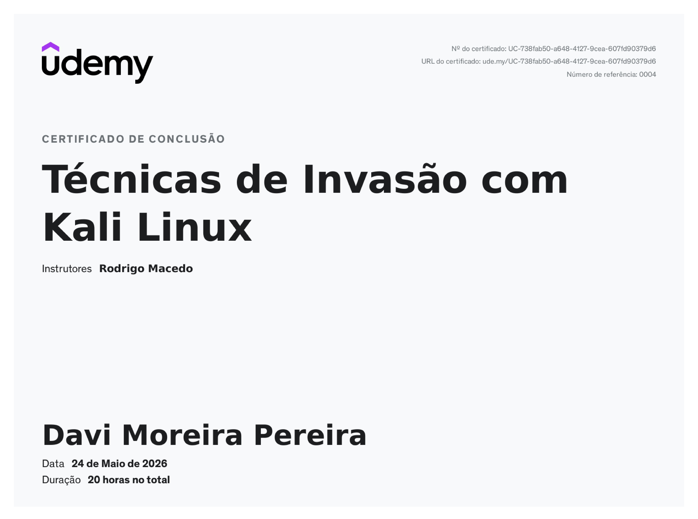
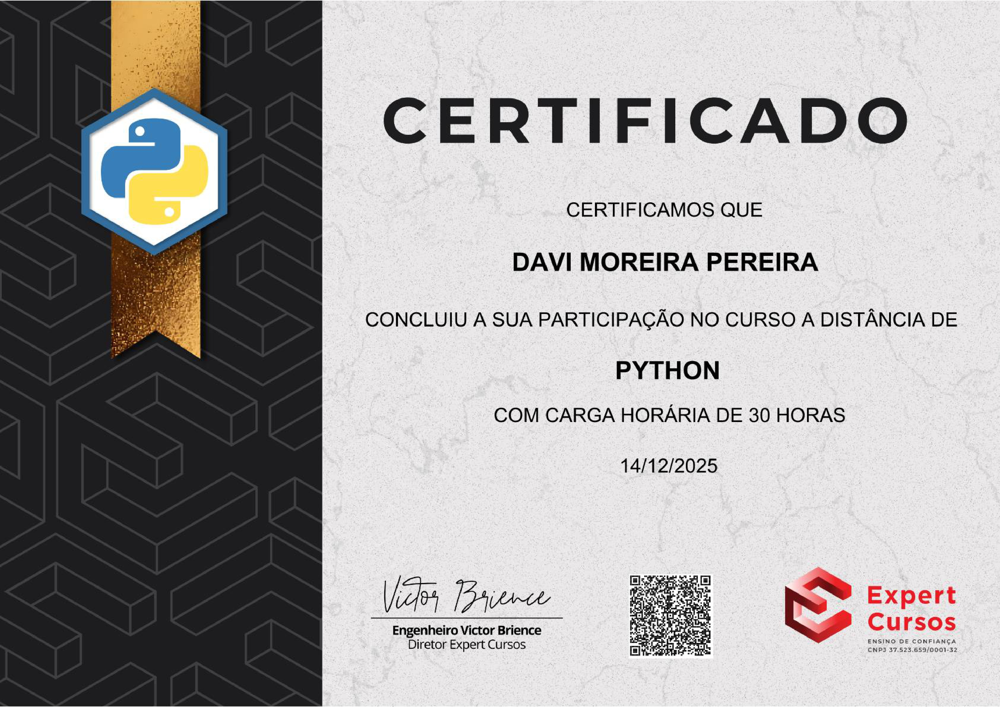

# Meus Certificados

Este repositório contém meus certificados profissionais e de conclusão de cursos. Clique nas imagens para abrir os arquivos em tamanho real na pasta `Certificates/`.

## Certificados

### Google Cibersegurança
**Plataforma:** Coursera  
**Especialização:** Google Cibersegurança

---

### Hacking Ético
**Plataforma:** Coursera  
**Especialização:** Hacking Ético

---

### Hacking Ético (CEH)
**Plataforma:** Coursera  
**Especialização:** Hacking Ético (CEH)

---

### Técnicas de Invasão com Kali Linux
**Plataforma:** Udemy  
**Curso:** Técnicas de Invasão com Kali Linux

---

### Python
**Plataforma:** Hotmart  
**Curso:** Python

---

## Observações
- Os arquivos originais dos certificados estão armazenados na pasta `Certificates/`.
