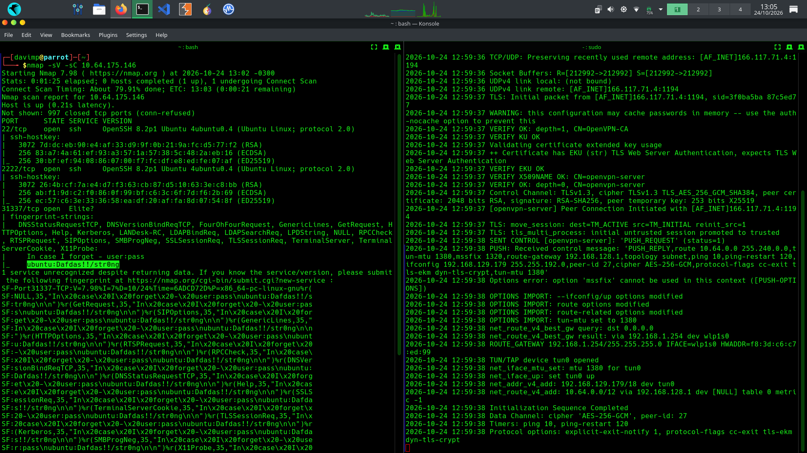
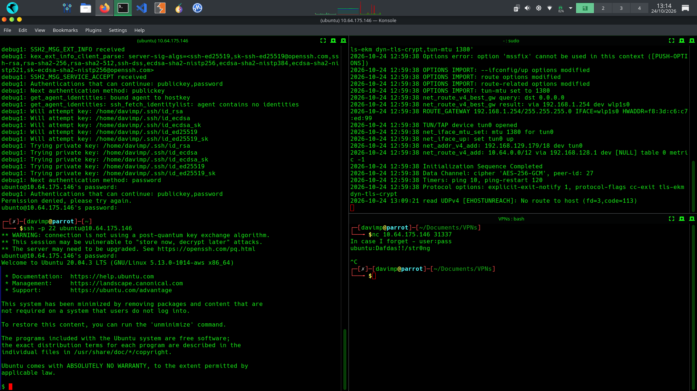
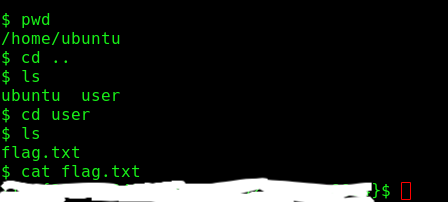
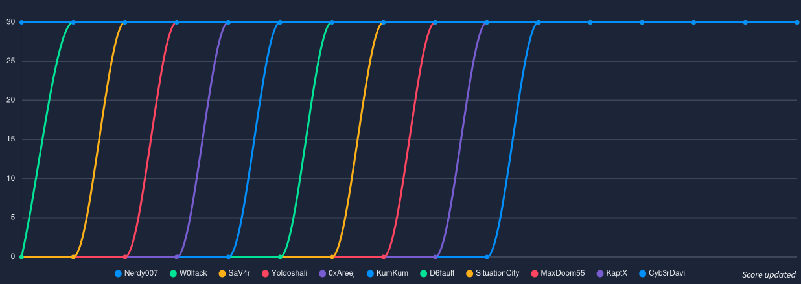

# Intermediate Nmap — TryHackMe

Documentação da resolução do laboratório **Intermediate Nmap**, da plataforma [TryHackMe](https://tryhackme.com/).

O objetivo do desafio era encontrar a flag `flag.txt` utilizando o Nmap para reconhecer os serviços disponíveis no alvo e o SSH para acessar o servidor. Durante a enumeração, consegui identificar três portas abertas e descobrir credenciais SSH por meio dos scripts do Nmap.

## Ferramentas utilizadas

- **Nmap:** reconhecimento de portas, identificação de serviços e execução de scripts de enumeração.
- **SSH:** acesso remoto ao servidor utilizando as credenciais encontradas.

## 1. Reconhecimento com Nmap

Comecei com uma varredura utilizando os parâmetros `-sV` e `-sC`:

```bash
nmap -sV -sC 10.64.175.146
```

O parâmetro `-sV` tenta identificar os serviços e suas versões, enquanto o `-sC` executa um conjunto padrão de scripts do Nmap, úteis para coletar informações adicionais sobre os serviços encontrados.

A varredura identificou três portas abertas:

| Porta | Serviço identificado |
|---|---|
| 22/tcp | SSH |
| 2222/tcp | SSH |
| 31337/tcp | Elite |

O resultado mais importante foi obtido durante a execução dos scripts associados à porta `31337`. As informações retornadas permitiram identificar um usuário e uma senha para o acesso via SSH.

Essa etapa foi essencial para definir o próximo passo da exploração.



*Figura 1 — Varredura do alvo, portas identificadas e informações obtidas pelos scripts do Nmap.*

## 2. Acesso ao servidor via SSH

Com as credenciais em mãos, utilizei o SSH para estabelecer uma conexão remota com o servidor.

```bash
ssh ubunto@10.64.175.146
```

Após executar o comando, informei a senha descoberta na etapa anterior. Com a autenticação concluída, consegui acessar o ambiente remoto e continuar a busca pela flag.



*Figura 2 — Conexão SSH estabelecida utilizando as credenciais encontradas durante a enumeração.*

## 3. Localização da flag

Depois de entrar no servidor, procurei pelo arquivo `flag.txt`, solicitado pelo laboratório.

A busca foi realizada diretamente no ambiente remoto, sem a necessidade de utilizar o Netcat ou outras ferramentas para obter a flag.

A captura de tela abaixo registra essa etapa. O conteúdo da flag foi borrado para evitar sua divulgação.



*Figura 3 — Localização do arquivo `flag.txt`. O conteúdo foi ocultado na imagem.*

## 4. Resultado no TryHackMe

O laboratório foi concluído com sucesso. Também registrei a classificação exibida na plataforma, na qual meu nome de usuário, **Cyb3rDavi**, aparece entre os participantes.



*Figura 4 — Classificação exibida pelo TryHackMe.*

## Conclusão

O laboratório foi tranquilo de resolver e serviu como uma boa prática de reconhecimento de serviços com o Nmap.

O principal aprendizado foi perceber como os scripts padrão do Nmap podem revelar informações relevantes além da simples identificação de portas abertas. Nesse caso, a enumeração forneceu as credenciais necessárias para acessar o servidor via SSH e localizar a flag.

Foi um desafio simples, mas interessante para reforçar o uso do Nmap em uma etapa inicial de reconhecimento.

---

**Laboratório:** Intermediate Nmap  
**Plataforma:** TryHackMe  
**Usuário:** Cyb3rDavi  
**Ferramentas:** Nmap e SSH  
**Status:** Concluído
