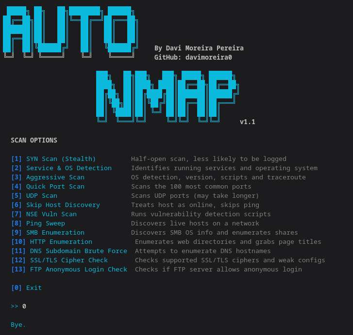

<div align="center">
  
</div>

<div align="center">
  
# AutoNmap v1.1

**An interactive, menu-driven nmap wrapper for faster and smarter network reconnaissance.**

[](https://python.org)
[](https://nmap.org)
[](LICENSE)
[](https://GitHub.com/davimoreira0/AutoNmap/graphs/commit-activity)

</div>

---

## About

**AutoNmap** gives you a sleek, menu-driven terminal interface around `nmap` so you don't have to memorize complex flags and syntax. Whether you are doing a quick ping sweep or a deep vulnerability assessment using the Nmap Scripting Engine (NSE), just pick a scan type, enter your target, and let the script do the heavy lifting.

## Features

* **User-Friendly:** Interactive terminal UI built with Colorama.
* **Time-Saving:** 13 pre-configured scan profiles covering the most common recon scenarios.
* **Advanced NSE Integration:** Ready-to-use vulnerability and enumeration scripts for SMB, HTTP, DNS, SSL, and FTP.
* **Error Handling:** Built-in checks to ensure dependencies are met before execution.

## Screenshot



---

## Available Scan Profiles

| # | Profile Name | Description | Command Executed |
|---|--------------|-------------|------------------|
| **1** | SYN Scan (Stealth) | Half-open scan, less likely to be logged by firewalls. | `-sS` |
| **2** | Service & OS Detection | Identifies running services, versions, and operating system. | `-sV -O` |
| **3** | Aggressive Scan | Full recon (OS detection, versioning, scripts, and traceroute). | `-A` |
| **4** | Quick Port Scan | Scans only the 100 most common ports for a fast overview. | `-F` |
| **5** | UDP Scan | Checks UDP ports (DNS, SNMP, etc.). *Note: Can be slow.* | `-sU` |
| **6** | Skip Host Discovery | Treats the host as online, skipping the initial ping check. | `-Pn` |
| **7** | NSE Vuln Scan | Runs standard vulnerability detection scripts against the target. | `--script=vuln` |
| **8** | Ping Sweep | Discovers live hosts on a subnet without scanning ports. | `-sn` |
| **9** | SMB Enumeration | Discovers precise OS info and enumerates SMB shares. | `-p 139,445 --script smb-...` |
| **10** | HTTP Enumeration | Searches for common web directories and grabs page titles. | `-p 80,443 --script http-...` |
| **11** | DNS Subdomain Brute | Attempts to enumerate DNS hostnames via brute force. | `-p 53 --script dns-brute` |
| **12** | SSL/TLS Cipher Check | Evaluates supported SSL/TLS ciphers and flags weak configs. | `-p 443 --script ssl-enum...` |
| **13** | FTP Anonymous Check | Checks if the FTP server allows anonymous, passwordless login. | `-p 21 --script ftp-anon` |

---

## Installation & Setup

**1. Clone the repository:**
```bash
git clone https://github.com/davimoreira0/AutoNmap.git
cd AutoNmap

```

**2. Set up a virtual environment (Recommended):**

```bash
python3 -m venv .venv
source .venv/bin/activate

```

**3. Install dependencies:**

```bash
pip install colorama

```

**4. Run the tool:**

```bash
sudo python3 setup.py

```

> **Note:** Many scan types (like SYN Scans and OS Detection) require `sudo` privileges for raw socket access.

---

## Requirements

* **Python 3.8+**
* **[Nmap](https://nmap.org/download.html)** installed and accessible in your system's `PATH`.
* **OS:** Linux natively supported (tested on Kali Linux / Ubuntu).

---

## Legal Disclaimer

This tool is designed for **educational purposes and authorized security testing only**. Do not use AutoNmap to scan networks, IP addresses, or domains that you do not own or do not have explicit, written permission to test. The author is not responsible for any misuse or damage caused by this program.

---

## Author

**Davi Moreira Pereira** - GitHub: [@davimoreira0](https://github.com/davimoreira0)